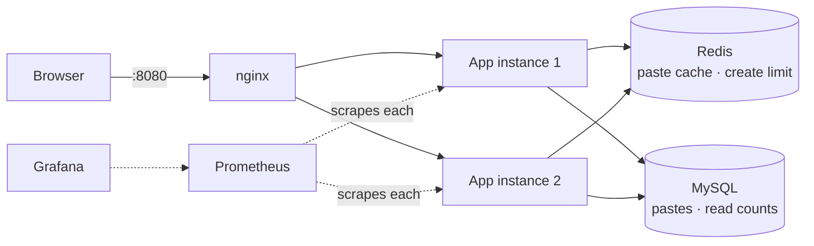
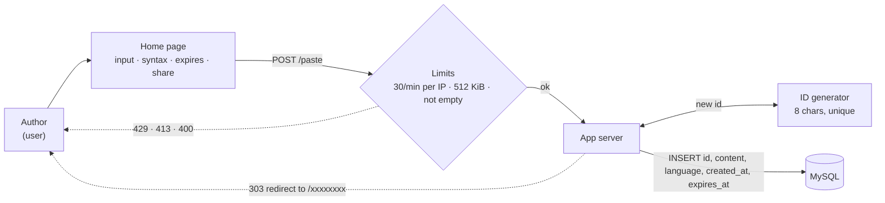
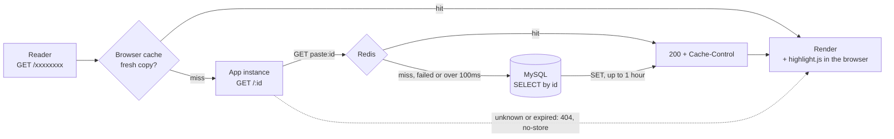
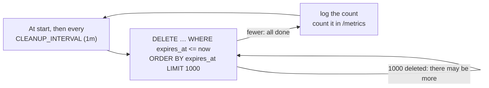
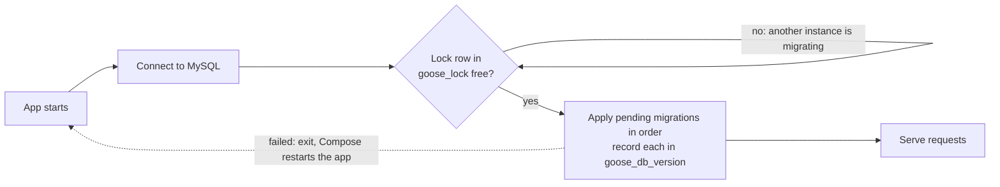

# pastebin

This is a working implementation of the Pastebin design from
[system-design-primer](https://github.com/donnemartin/system-design-primer/blob/master/solutions/system_design/pastebin/README.md).

## Design

### Overview



nginx is the only way in. It spreads requests over the two app instances and moves on when one dies. Everything the instances have to agree on lives outside them: pastes and read counts in MySQL, the cache and the create limit in Redis. [When something fails](#when-something-fails) says what each failure costs.

### Write flow



The home page form posts to `POST /paste`. The server generates an 8-character ID, saves the paste to MySQL, and redirects to `/<id>`, where the share link is shown.

Limits are checked before anything reaches MySQL:

- **Rate:** one client IP may create 30 pastes a minute, after a burst of 10. Past that it gets `429` with `Retry-After`. The count is a token bucket in Redis, so it holds across instances. If Redis fails or takes 100ms, the instance applies its own limit in memory: the limit stays on and is only looser, by the number of instances, until Redis is back.
- **Client IP:** the one nginx puts in `X-Real-IP`, overwriting what the client sent. The app believes that header only from a private address, and ignores `X-Forwarded-For`, which any client can set.
- **Size:** content over 512 KiB gets `413`. The body is cut off before it is parsed, at three times that plus 4 KiB, because URL encoding can triple a byte.
- **Empty:** content that is empty or only whitespace gets `400`.

### Read flow



`GET /<id>` loads the paste and renders it. The response carries `Cache-Control: private, max-age=…`, capped at 24 hours and never past the paste's expiry. Within that window the reader's browser can serve repeat visits from its own cache. `private` stays: there's no shared cache in the stack that could use `public`.

Between the app and MySQL sits Redis, cache-aside under the key `paste:<id>`:

- **A paste** stays for an hour plus up to 6 minutes of jitter, so pastes first read together don't all come back to MySQL together. It never stays past its expiry. A paste never changes, so nothing can go stale.
- **An unknown id** is remembered for 30 seconds, so requests for ids that don't exist can't each cost a query. Creating a paste clears the marker for its id.
- **Reads of one id share one load,** so a paste that just left the cache costs one query per instance however many are reading it. A client leaving doesn't fail the others waiting.
- **Redis failing never fails a read.** A failed call, or one over 100ms, falls back to MySQL, logs a warning and counts in `/metrics`. Redis is then left alone for a second, so a hung Redis doesn't cost every read 100ms. MySQL errors are never cached.

Syntax highlighting runs in the browser (highlight.js, vendored under `handlers/static/vendor`). The server only stores the language name, so the read path has no highlighting work.

### Read counts

`GET /<id>/stats` answers `{"id":"aB3xK9pQ","views":42}`, the reads that reached the server. Repeat visits served from the browser's cache aren't counted.

A read only adds to a counter in memory. Once a minute each instance writes its counts in one `UPDATE … CASE id … WHERE id IN (…)`, at most 500 pastes per statement and sorted by id, so two instances lock rows in the same order and can't deadlock. A read never waits on a row lock. A failed write keeps its counts for the next one, and shutdown writes once more. A crash loses up to a minute of counts.

MySQL runs with `binlog_row_image=MINIMAL`. With the default, `FULL`, each of those updates would write the whole row to the binlog, content included, twice.

The paste page doesn't show the count: it can stay cached for an hour in Redis and a day in the browser, and the number would look stuck.

### Expiry cleanup



A paste past its expiry gets a `404` at once. Its row stays until the cleanup job, which runs inside the app, deletes it: at start and then every minute, it deletes the pastes that have expired, at most 1000 per `DELETE`, until a batch comes back short. It finds them through the index on `expires_at`, so each `DELETE` reads only the rows it removes and holds their locks only until it commits. Pastes that never expire are never read.

A run starts by taking a MySQL lock with `GET_LOCK`, without waiting, and an instance that doesn't get it skips that run. So one instance deletes at a time. The lock belongs to a connection, so MySQL frees it if the instance dies.

A run that deletes something logs how many, e.g. `INFO cleanup deleted=1000 duration=…`, and `/metrics` counts the deleted pastes and the failed runs. On shutdown the batch under way finishes first. InnoDB reuses the freed space for new rows; the data file doesn't shrink.

### Timeouts and the DB pool

Nothing waits forever, so a slow client or a stalled MySQL can't pile up connections:

- **Connection:** the headers must arrive within 5s and the whole request within 10s. The response must be written within 15s. An idle keep-alive connection is closed after 60s. nginx applies these to the client and the app to nginx. nginx's own idle connections to the app close after 30s, before the app's 60s, so it never sends a request on one the app is closing.
- **Request:** every request has 5s, including the wait for a DB connection. One that runs out gets `503` and a `WARN` log line. A client that leaves first gets `499` and an `INFO` line; that isn't a server error.
- **MySQL:** each connection tells MySQL to give up on a statement, or on waiting for a lock, after 2s (`max_execution_time`, `lock_wait_timeout`, `innodb_lock_wait_timeout`). This has to come before the request deadline: a cancelled request only closes the app's end, and MySQL would keep waiting on its own.
- **Redis:** each call has 100ms, with no retry. Then the app goes on without it.
- **Pool:** at most 50 connections per instance, so 100 for the two, under MySQL's `max_connections` of 151. Requests past that wait for a free one. Idle connections are kept for reuse, so a burst doesn't open and close one per query.

### When something fails

| What dies | What it costs |
|---|---|
| One app instance | Nearly nothing. nginx retries a `GET` that fails on the other instance and leaves the dead one alone for 5s. A `POST` isn't retried, so no paste is created twice, and one under way gets a `502`. |
| Redis | Every read goes to MySQL, so it is slower. Each instance applies its own create limit, so the limit is twice as loose. |
| MySQL | Creates fail. Pastes in Redis can still be read and others fail. `/health` turns `503`. Read counts wait in memory. |
| nginx | Everything: it is the only way in. |
| The disk under MySQL | Everything since the last `make backup`. There is no replica. |

### Schema migrations



The schema is the numbered [goose](https://github.com/pressly/goose) SQL files in `migrations/`, embedded in the binary. On start the app applies the ones the database hasn't had yet, before it serves anything, so no request reads a column that isn't there. `make run` on an existing volume brings it up to date; an empty volume gets the whole schema.

Instances that start together take turns: one holds the lock and migrates, the others wait and then find nothing to do. If the holder dies, its 30s lease runs out and another instance takes over.

Writing a migration:

- Add the next number, e.g. `00005_add_something.sql`, starting with `-- +goose Up`. Migrations only go forward: never edit one that has been applied anywhere; to undo it, add another.
- One statement per file. MySQL commits each DDL statement on its own, so if the second statement of a file fails, the first stays applied and goose records nothing.
- A new column gets a default or allows `NULL`, so the previous app version keeps working while a deploy or a rollback is under way.
- Add `ALGORITHM = INSTANT` where MySQL supports it: the column goes into the table's metadata without rewriting the rows, and if it can't, the migration fails instead of rebuilding the table.
- An index can't be INSTANT. Add it with `ALGORITHM = INPLACE LOCK = NONE`: MySQL builds it while reads and writes go on. It still reads the whole table, and the instance applying it serves nothing until it is done.
- Migrations run with the same 2s lock wait as requests. An `ALTER` that can't get its table lock in 2s fails and is retried when the app restarts, instead of making every read of that table queue behind it.

## Run

```sh
make build    # build the app image
make run      # start app, MySQL and monitoring in the background (rebuilds if code changed) → http://localhost:8080
make stop     # stop the containers, keep them and the data
make remove   # delete containers, network, data volumes (MySQL, Prometheus) and the app image
make backup   # dump the database to backups/ while the app keeps running
```

To restore a dump, which replaces the tables it contains:

```sh
gunzip -c backups/pastebin-….sql.gz | docker compose exec -T mysql sh -c 'MYSQL_PWD="$MYSQL_ROOT_PASSWORD" exec mysql -uroot "$MYSQL_DATABASE"'
```

`make run` doesn't notice a change to `nginx/nginx.conf` or `monitoring/prometheus.yml`, because they are mounted files. After changing one, run `docker compose restart nginx` or `docker compose restart prometheus`.

`./scripts/smoke.sh` runs an end-to-end check against the running stack.

`scripts/load/` holds the [k6](https://k6.io) load tests: `read.js` for readers and `write.js` for authors. Each file starts with its usage, e.g. `k6 run -e VUS=300 scripts/load/read.js`. k6 sends everything from one IP, so start the stack with the create limit off first: `RATE_LIMIT_CREATES_PER_MINUTE=0 make run`.

## Configuration

| Variable | Default |
|---|---|
| `PORT` | `8080` |
| `BASE_URL` | `http://localhost:8080` |
| `DB_HOST` / `DB_PORT` | `localhost` / `3306` |
| `DB_USER` / `DB_PASSWORD` / `DB_NAME` | `pastebin` / `pastebin` / `pastebin` |
| `DB_MAX_OPEN_CONNS` | `50`. At least 1. |
| `DB_MAX_IDLE_CONNS` | the same as `DB_MAX_OPEN_CONNS`. At least 1. |
| `DB_CONN_MAX_LIFETIME` | `5m`, a Go duration. |
| `RATE_LIMIT_CREATES_PER_MINUTE` | `30` per client IP, after a burst of 10. `0` turns the limit off. |
| `CLEANUP_INTERVAL` | `1m`, a Go duration: how often expired pastes are deleted. |
| `VIEWS_INTERVAL` | `1m`, a Go duration: how often read counts are written to MySQL. |
| `REDIS_ADDR` | `localhost:6379`. The app runs without Redis if it can't reach it. |

## Observability

Every request is logged, e.g. `INFO request method=GET path=/aB3xK9pQ status=200 latency=1.2ms`.

| Endpoint | What |
|---|---|
| `GET /health` | `200 ok` while MySQL answers a ping within 1s, `503` otherwise. Compose uses it as the app's healthcheck. It is a readiness check: when MySQL is down, restarting the app doesn't help, so don't wire it to a restart. |
| `GET /metrics` | Prometheus text format. `pastebin_http_request_duration_seconds` is a latency histogram by method, route and status. `pastebin_pastes_created_total` counts stored pastes by language and expiry option, and `pastebin_paste_size_bytes` is their size histogram. `go_sql_*` is the DB pool: open, in use and idle connections, wait count and wait time. `pastebin_expired_pastes_deleted_total` and `pastebin_cleanup_failures_total` are the cleanup job's. `pastebin_cache_requests_total` counts cache lookups by result (`hit`, `miss`, `error`); reads sharing one load count once. `pastebin_views_flushed_total`, `pastebin_views_flush_failures_total` and `pastebin_views_dropped_total` are the read counts'. `pastebin_rate_limit_fallbacks_total` counts creates checked against an instance's own limit. Go runtime and process metrics are included too. Each instance reports its own, so through nginx this shows whichever instance answers. |

### Monitoring

`make run` also starts the monitoring stack:

| Service | What |
|---|---|
| Prometheus, http://localhost:9090 | Scrapes each app instance's `/metrics` and node-exporter every 5s, so a 30s load test gets enough points. Data survives `make stop`; `make remove` deletes it. |
| node-exporter | CPU, memory and load of the machine the containers run on. Under Docker Desktop that machine is its Linux VM (the CPUs and memory given to Docker), not the Mac. Its network metrics only see its own container. |
| Grafana, http://localhost:3000 | Dashboards, open without signing in (admin/admin to sign in). **Machine resources** is the home page: CPU, memory and load of the machine, and the app process's CPU and memory next to it. **Usage**: creates and reads, their latency, what gets stored (language, expiry, size), the DB pool and the Redis cache under that traffic. |

The dashboards are JSON files in `monitoring/grafana/dashboards`. Grafana doesn't save changes made in its UI; to change a dashboard, edit the file (or export it from the UI into the file). Grafana rereads the files every 10 seconds.

Usage counts what reaches the server. Repeat reads served from the reader's browser cache aren't counted. Neither are reads per paste, since one series per paste id would grow without bound; `GET /<id>/stats` answers that.

## Develop

```sh
go test ./...
```

## Layout

| Path | What |
|---|---|
| `main.go` | entrypoint: wires the pieces together in order |
| `nginx` | the load balancer's config |
| `environments` | settings read from env vars |
| `routes/api.go` | URL → handler mapping |
| `handlers` | request handling, HTML templates, static assets (CSS, JS, highlight.js), `Cache-Control`, create rate limit and body size limit |
| `internal/providers` | startup steps: DB connection and migrations, Redis client, metrics, expiry cleanup, read counts, middlewares (request log, request deadline), renderer, server start/shutdown and its timeouts |
| `internal/metrics` | what `/metrics` reports: request latency histogram, created pastes and their size, DB pool stats, the counts of the cleanup job, the cache, the read counters and the create limit |
| `internal/idgen` | random 8-char base62 IDs |
| `internal/paste` | create with a unique ID (retries on collision), rejecting empty content and content over 512 KiB; read with expiry check |
| `internal/cache` | the paste cache in Redis, in front of the store: shared loads, TTLs, falling back to MySQL |
| `internal/views` | read counts per paste: counted in memory, written in batches |
| `internal/ratelimit` | the create limit's token bucket in Redis |
| `internal/cleanup` | the background job that deletes expired pastes, a batch at a time |
| `internal/mysqlstore` | MySQL implementation of the paste store: pool size, statement timeout, migrations under a lock, deleting expired pastes under a lock, writing read counts |
| `migrations` | schema as numbered goose SQL files, embedded in the binary and applied at start |
| `monitoring` | Prometheus scrape config; Grafana data source and dashboards, loaded from files at start |
