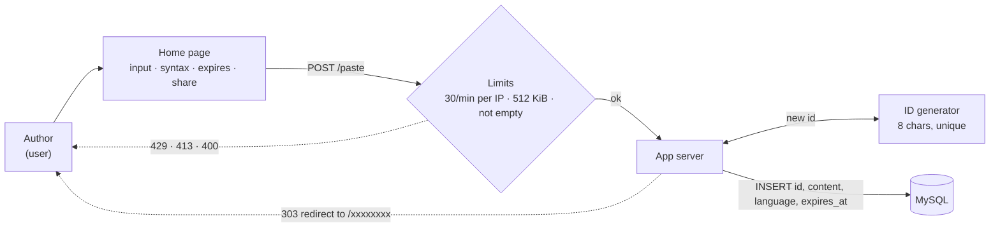
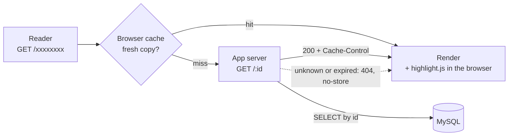
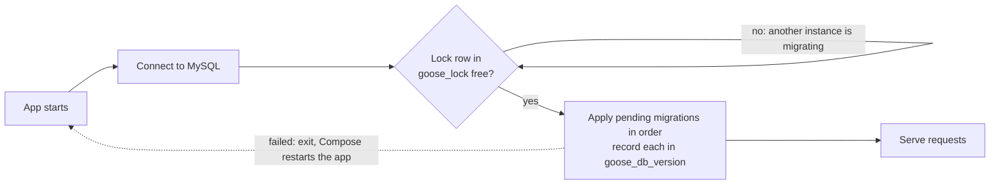

# pastebin

This is a working implementation of the Pastebin design from
[system-design-primer](https://github.com/donnemartin/system-design-primer/blob/master/solutions/system_design/pastebin/README.md).

## Design (v1)

### Write flow



The home page form posts to `POST /paste`. The server generates an 8-character ID, saves the paste to MySQL, and redirects to `/<id>`, where the share link is shown.

Limits are checked before anything reaches MySQL:

- **Rate:** one client IP may create 30 pastes a minute, after a burst of 10. Past that it gets `429` with `Retry-After`. The IP is the TCP peer's; `X-Forwarded-For` is ignored, because nothing sits in front of the app.
- **Size:** content over 512 KiB gets `413`. The body is cut off before it is parsed, at three times that plus 4 KiB, because URL encoding can triple a byte.
- **Empty:** content that is empty or only whitespace gets `400`.

### Read flow



`GET /<id>` loads the paste from MySQL and renders it. The response carries `Cache-Control: private, max-age=…`, capped at 24 hours and never past the paste's expiry. Within that window the reader's browser can serve repeat visits from its own cache.

Syntax highlighting runs in the browser (highlight.js, vendored under `handlers/static/vendor`). The server only stores the language name, so the read path stays a single `SELECT` with no highlighting work.

### Timeouts and the DB pool

Nothing waits forever, so a slow client or a stalled MySQL can't pile up connections:

- **Connection:** the headers must arrive within 5s and the whole request within 10s. The response must be written within 15s. An idle keep-alive connection is closed after 60s.
- **Request:** every request has 5s, including the wait for a DB connection. One that runs out gets `503` and a `WARN` log line. A client that leaves first gets `499` and an `INFO` line; that isn't a server error.
- **MySQL:** each connection tells MySQL to give up on a statement, or on waiting for a lock, after 2s (`max_execution_time`, `lock_wait_timeout`, `innodb_lock_wait_timeout`). This has to come before the request deadline: a cancelled request only closes the app's end, and MySQL would keep waiting on its own.
- **Pool:** at most 50 connections, under MySQL's `max_connections` of 151 with room for a second instance. Requests past that wait for a free one. Idle connections are kept for reuse, so a burst doesn't open and close one per query.

### Schema migrations



The schema is the numbered [goose](https://github.com/pressly/goose) SQL files in `migrations/`, embedded in the binary. On start the app applies the ones the database hasn't had yet, before it serves anything, so no request reads a column that isn't there. `make run` on an existing volume brings it up to date; an empty volume gets the whole schema.

Instances that start together take turns: one holds the lock and migrates, the others wait and then find nothing to do. If the holder dies, its 30s lease runs out and another instance takes over.

Writing a migration:

- Add the next number, e.g. `00003_add_something.sql`, starting with `-- +goose Up`. Migrations only go forward: never edit one that has been applied anywhere; to undo it, add another.
- One statement per file. MySQL commits each DDL statement on its own, so if the second statement of a file fails, the first stays applied and goose records nothing.
- A new column gets a default or allows `NULL`, so the previous app version keeps working while a deploy or a rollback is under way.
- Add `ALGORITHM = INSTANT` where MySQL supports it: the column goes into the table's metadata without rewriting the rows, and if it can't, the migration fails instead of rebuilding the table.
- Migrations run with the same 2s lock wait as requests. An `ALTER` that can't get its table lock in 2s fails and is retried when the app restarts, instead of making every read of that table queue behind it.

## Run

```sh
make build    # build the app image
make run      # start app, MySQL and monitoring in the background (rebuilds if code changed) → http://localhost:8080
make stop     # stop the containers, keep them and the data
make remove   # delete containers, network, data volumes (MySQL, Prometheus) and the app image
```

`./scripts/smoke.sh` runs an end-to-end check against the running stack.

`scripts/load/` holds the [k6](https://k6.io) load tests: `read.js` for readers and `write.js` for authors. Each file starts with its usage, e.g. `k6 run -e VUS=300 scripts/load/read.js`. k6 sends everything from one IP, so start the stack with the create limit off first: `RATE_LIMIT_CREATES_PER_MINUTE=0 make run`.

## Configuration

| Variable | Default |
|---|---|
| `PORT` | `8080` |
| `BASE_URL` | `http://localhost:8080` |
| `DB_HOST` / `DB_PORT` | `localhost` / `3306` |
| `DB_USER` / `DB_PASSWORD` / `DB_NAME` | `pastebin` / `pastebin` / `pastebin` |
| `DB_MAX_OPEN_CONNS` | `50`. At least 1. |
| `DB_MAX_IDLE_CONNS` | the same as `DB_MAX_OPEN_CONNS`. At least 1. |
| `DB_CONN_MAX_LIFETIME` | `5m`, a Go duration. |
| `RATE_LIMIT_CREATES_PER_MINUTE` | `30` per client IP, after a burst of 10. `0` turns the limit off. |

## Observability

Every request is logged, e.g. `INFO request method=GET path=/aB3xK9pQ status=200 latency=1.2ms`.

| Endpoint | What |
|---|---|
| `GET /health` | `200 ok` while MySQL answers a ping within 1s, `503` otherwise. Compose uses it as the app's healthcheck. It is a readiness check: when MySQL is down, restarting the app doesn't help, so don't wire it to a restart. |
| `GET /metrics` | Prometheus text format. `pastebin_http_request_duration_seconds` is a latency histogram by method, route and status. `pastebin_pastes_created_total` counts stored pastes by language and expiry option, and `pastebin_paste_size_bytes` is their size histogram. `go_sql_*` is the DB pool: open, in use and idle connections, wait count and wait time. Go runtime and process metrics are included too. |

### Monitoring

`make run` also starts the monitoring stack:

| Service | What |
|---|---|
| Prometheus, http://localhost:9090 | Scrapes the app's `/metrics` and node-exporter every 5s, so a 30s load test gets enough points. Data survives `make stop`; `make remove` deletes it. |
| node-exporter | CPU, memory and load of the machine the containers run on. Under Docker Desktop that machine is its Linux VM (the CPUs and memory given to Docker), not the Mac. Its network metrics only see its own container. |
| Grafana, http://localhost:3000 | Dashboards, open without signing in (admin/admin to sign in). **Machine resources** is the home page: CPU, memory and load of the machine, and the app process's CPU and memory next to it. **Usage**: creates and reads, their latency, what gets stored (language, expiry, size) and the DB pool under that traffic. |

The dashboards are JSON files in `monitoring/grafana/dashboards`. Grafana doesn't save changes made in its UI; to change a dashboard, edit the file (or export it from the UI into the file). Grafana rereads the files every 10 seconds.

Usage counts what reaches the server. Repeat reads served from the reader's browser cache aren't counted, and neither are reads per paste: one series per paste id would grow without bound.

## Develop

```sh
go test ./...
```

## Layout

| Path | What |
|---|---|
| `main.go` | entrypoint: wires the pieces together in order |
| `environments` | settings read from env vars |
| `routes/api.go` | URL → handler mapping |
| `handlers` | request handling, HTML templates, static assets (CSS, JS, highlight.js), `Cache-Control`, create rate limit and body size limit |
| `internal/providers` | startup steps: DB connection and migrations, metrics, middlewares (request log, request deadline), renderer, server start/shutdown and its timeouts |
| `internal/metrics` | what `/metrics` reports: request latency histogram, created pastes and their size, DB pool stats |
| `internal/idgen` | random 8-char base62 IDs |
| `internal/paste` | create with a unique ID (retries on collision), rejecting empty content and content over 512 KiB; read with expiry check |
| `internal/mysqlstore` | MySQL implementation of the paste store: pool size, statement timeout, migrations under a lock |
| `migrations` | schema as numbered goose SQL files, embedded in the binary and applied at start |
| `monitoring` | Prometheus scrape config; Grafana data source and dashboards, loaded from files at start |
